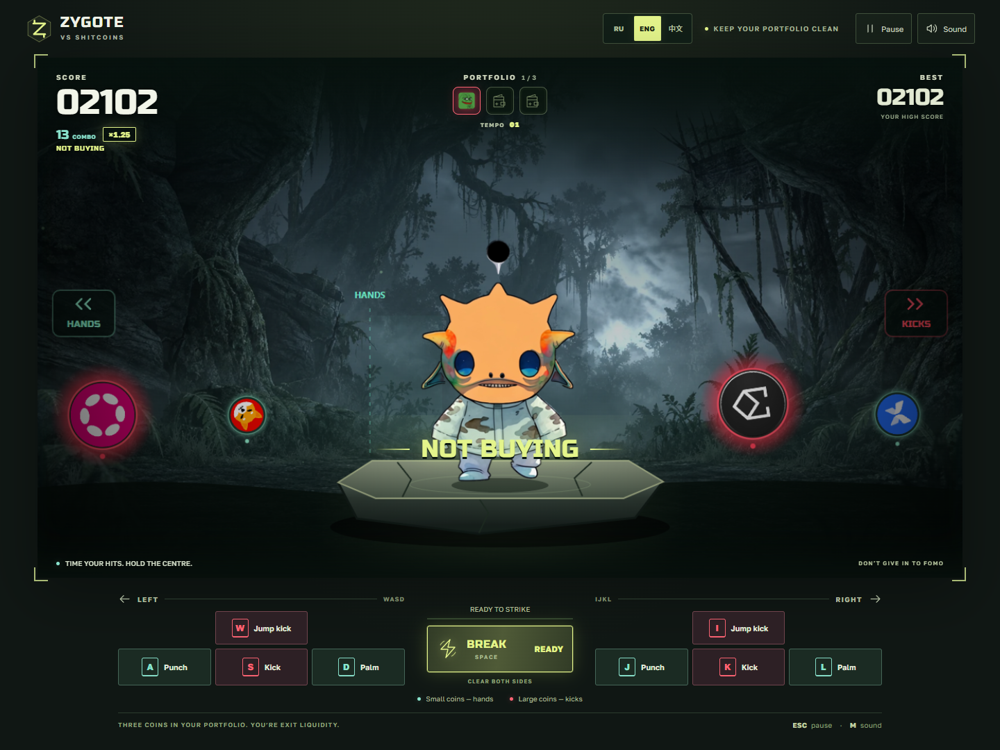

# Zygote vs Shitcoins

**Deflect the hype. Keep your portfolio clean.**

A kung-fu score attack arcade game: defend both sides of the platform, time each hit and send incoming shitcoins flying. Every coin you miss ends up in your portfolio. Fill all three slots and you become exit liquidity.

**[Play in your browser](https://azkian1.github.io/zyg-shitcoins/?lang=en)**

[Project map](project.md) — file responsibilities, game systems and release workflow.

## How to play

- **Small coins:** punch or palm strike.
- **Large coins with a red glow:** kick or jump kick.
- Strike when a coin reaches the highlighted zone beside Zygote. Precise timing earns a perfect hit.
- Keep your three portfolio slots empty for as long as you can. The tempo and coin speed increase as the round continues.

The first two purchases flash **BOUGHT** with a familiar investing excuse. Fill the third slot and the round ends with the three coins you actually caught.

## Controls

| Attack | Left side · WASD | Right side · IJKL |
| --- | :---: | :---: |
| Jump kick | **W** | **I** |
| Punch | **A** | **J** |
| Kick | **S** | **K** |
| Palm strike | **D** | **L** |

**Space** activates Break when fully charged. **Esc** pauses or resumes. **M** toggles sound.

On-screen buttons support mouse and touch. Keyboard controls use physical key positions, so they also work with non-English keyboard layouts.

Every attack returns to the relaxed, bouncing neutral pose. On your last life, Zygote raises a kung-fu guard instead. The hands lower through neutral before the next strike, within its existing windup, so hit timing stays the same.

## Build your streak

Successful hits charge **Break**: a regular hit adds **9%**, a perfect hit adds **16%**. When the button lights up, unleash a circular sweep that clears coins on both sides—or save it for a tougher moment.

Reach **10, 25 and 50 consecutive hits** to unlock new combo titles, brighter attack trails and musical accents. The streak counter and score multiplier are shown separately. Brief hit stops, contact flashes and directional shockwaves make every deflection feel sharp; kicks have heavier sound and knockback.

Reach the **purple 50-hit tier** with a coin in your portfolio to trigger **stop loss**: the most recently caught coin disappears and you regain one life. Each new streak can trigger this recovery once. The score multiplier remains separate from the color tiers.

## Languages

Choose **RU**, **ENG** or **中文** on the start screen or during a round. The interface switches immediately and remembers your choice in this browser. Your personal best is also stored locally.

## Run locally

Download or clone this repository and open `index.html` in a modern browser. You can also serve the repository folder with any static web server.

The game runs in the browser without a backend. Sprites, coin logos, music, custom SVG icons and fonts are bundled. Sound starts after you interact with the game. Russo One and Golos Text are distributed under the SIL Open Font License; their license texts are included in `assets/fonts/`.
